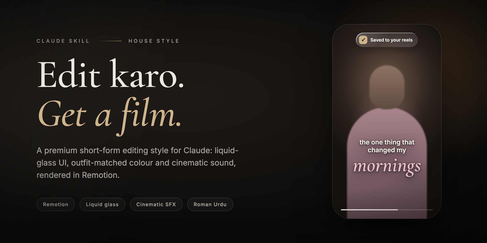
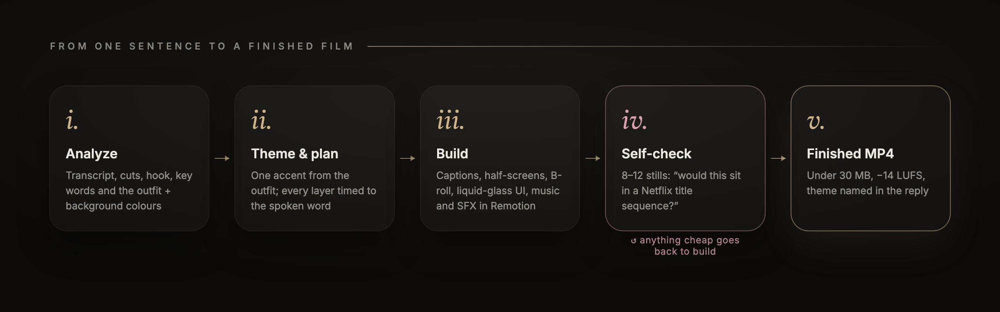
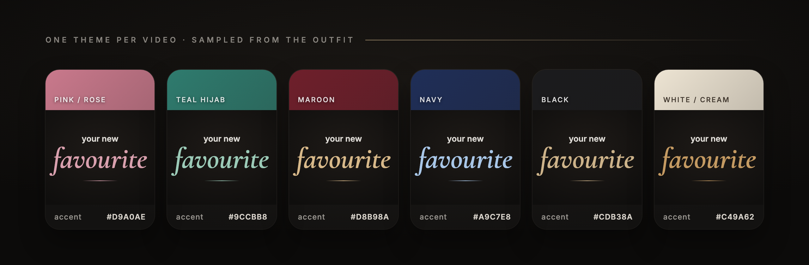

<div align="center">



<br>

# Video Editing Skill for Claude

**A premium short-form video-editing house style, packaged as Claude Agent Skills.**<br>
Say *"edit karo"* and get back a finished, Netflix-grade reel instead of a plan.

<br>

[](https://docs.claude.com/en/docs/agents-and-tools/agent-skills/overview)
[](https://www.remotion.dev/)
[](https://github.com/thisisfaizi/Video-Editing-Skill/releases/latest)
[](https://github.com/thisisfaizi/Video-Editing-Skill/stargazers)

[**Install**](#-install) · [**Usage**](#-usage) · [**How it works**](#-how-it-works) · [**The style**](#-the-style) · [**Make it yours**](#-make-it-your-own)

</div>

<br>

> [!NOTE]
> This is a real creator's house style, built from 22 rounds of feedback on real edits. Every rule in it exists because an earlier render got it wrong.

## ✦ What's inside

<table>
<tr>
<td width="50%" valign="top">

### 🎬 `short-form-video-editing`
**The default, used for every edit.**

Talking-head reels, shorts, product reels, intros and outros, and narration/biography videos built from a script.

- Captions below the face, with one serif hero word
- Apple liquid-glass UI and Dynamic-Island morphs
- Half-screens, B-roll cutaways and full-screen scenes
- A colour theme sampled from the speaker's outfit
- Original music and three-pass sound design

[Read the skill →](skills/short-form-video-editing/SKILL.md)

</td>
<td width="50%" valign="top">

### 🎙️ `creator-explainer-style`
**Opt-in, only when you ask for it.**

The explainer-shorts look, triggered by *"is style mein"* or *"behind-me captions wala"*.

- Key captions **behind** the person (rembg cut-out)
- White subtitle pills on every phrase
- Glowing stat numbers that count up
- 3D-tilted B-roll with depth of field, 50/50 splits
- A beat-driven bed with sub-booms on reveals

[Read the skill →](skills/creator-explainer-style/SKILL.md)

</td>
</tr>
</table>

## ⚡ Install

<details open>
<summary><b>Claude Code</b> (macOS / Linux)</summary>

<br>

```bash
git clone https://github.com/thisisfaizi/Video-Editing-Skill.git
cd Video-Editing-Skill
./scripts/install.sh        # symlinks both skills into ~/.claude/skills/
```

The skills are symlinked, so `git pull` updates them in place. To install into one project only:

```bash
./scripts/install.sh /path/to/project/.claude/skills
```

</details>

<details>
<summary><b>Claude.ai</b> (web and desktop app)</summary>

<br>

1. Download **`short-form-video-editing.zip`** and **`creator-explainer-style.zip`** from the [latest release](https://github.com/thisisfaizi/Video-Editing-Skill/releases/latest).
2. In Claude, open **Settings → Capabilities → Skills** and upload both zips.
3. Turn on code execution. The skill renders video, so it needs Node and ffmpeg in the sandbox.

To build the zips yourself, run `./scripts/package.sh`; they land in `dist/`.

</details>

<details>
<summary><b>Manual</b></summary>

<br>

Copy or symlink each folder in [`skills/`](skills) into `~/.claude/skills/`.

</details>

## 💬 Usage

Talk to Claude normally; the skill replies in Roman Urdu. Attach the video and say what you want:

| You say | You get |
|:---|:---|
| `Is reel ko edit karo` | The default style with every layer, delivered as a finished MP4 |
| `Product reel bana do, music nahi chahiye` | The full package without music, for this reel only |
| `Is video mein meri face chhupa do` | A real flower photo tracked over the face in every frame |
| `Yeh script hai, biography video banao` | A cinematic narration film, with a Kokoro voiceover if you don't supply one |
| `Is style mein edit karo` | Switches to `creator-explainer-style` for this one video |
| `Yeh 3 reference videos dekho aur seekho` | Frame-by-frame analysis, then a proposed skill update |

Every delivery ends with the theme it picked, e.g. *"Theme: dusty rose + off-white, matched to your pink dupatta and the warm wall."*

## 🧭 How it works

<div align="center">

</div>

<br>

Before the full render, Claude builds a contact sheet of 8–12 stills and asks of each one: *"Would this sit in a Netflix documentary title sequence?"* Anything childish, toy-like, meme-like or over-coloured gets replaced first.

### Every reel ships with all six layers

| | Layer | What it is |
|:---:|:---|:---|
| ✍️ | **Text** | 15–22 captions on key moments, plus a name tag |
| 🖼️ | **Full-screen animation** | 1–2 Apple-UI or metaphor scenes, 1.5–4 s each |
| 🎞️ | **B-roll** | 3–4 cinematic cutaways: macro crop, 0.72× slow-mo, light leak, grain |
| ◐ | **Half-screen** | Video in a rounded top card, the animation over a blurred copy below |
| 💎 | **Liquid-glass UI** | 5–7 morphing pills, cards and buttons, timed to the exact word |
| 🎵 | **Music + SFX** | An original track ~10 dB under the voice, plus layered stereo SFX |

## 🎨 The style

<div align="center">

</div>

<br>

**One theme per video, picked by Claude.** It samples the outfit and background (k-means in CIELAB, skin tones filtered out), then builds one accent at 35–55% saturation that reaches ≥ 4.5:1 contrast. Never rainbow, neon or CSS-gradient "gold".

| | ✅ Always | ❌ Never |
|:---|:---|:---|
| **Colour** | Lifted warm blacks, off-white `#EDE8DF`, one muted accent, a cinematic grade and grain | Saturated washes, yellow spotlight cones, a different theme per scene |
| **Type** | A display serif for hero words (Cormorant, Playfair, DM Serif) and a light sans for labels | Montserrat 900 all caps with glow ("YouTube bold") |
| **Motion** | Springs, letter-by-letter blur, one morphing container, slow dolly moves | Scale slams, camera shake, white flashes, spinning objects, clip-art |
| **3D** | Real glTF models with HDRI lighting, contact shadows, depth of field | Toy-like primitive models |
| **Sound** | Rich, layered SFX panned with the motion, one braam on the turning point | Thin "beepy" pops, a whoosh on every cut, cartoon foley in cinematic videos |
| **Frame** | The real video always visible, a 90px safe margin, consistent radii | Black panels behind animations, overlapping or cut-off text |

<details>
<summary><b>📜 All 22 user corrections at a glance</b></summary>

<br>

| # | Correction |
|:---:|:---|
| 1 | "Edit karo" means the complete video, not a plan |
| 2 | Never black out the bottom of the frame |
| 3 | Half-screen: rounded top card + blurred bottom half |
| 4 | Apple liquid glass and Apple UI motion over footage |
| 5 | Every animation unique and calm, held 0.6–1.5 s |
| 6 | Captions clearly below the face |
| 7 | Rich, premium SFX, never beepy |
| 8 | Keep the skill current (trends log, reference analysis) |
| 9 | The full package on every reel |
| 10 | Face hiding with zero leaks |
| 11 | A real flower photo, face-sized |
| 12 | Original music with a drop, ~10 dB under the voice |
| 13 | B-roll clearly different from the main footage |
| 14 | Check AI assets can be downloaded before spending credits |
| 15 | The creator-explainer style is opt-in only |
| 16 | Premium colour: one restrained palette |
| 17 | Editorial type, not "YouTube bold" |
| 18 | Cinematic animation, never cartoon-like |
| 19 | Sparse, deep, real-sounding cinematic SFX |
| 20 | A premium self-check on a contact sheet before rendering |
| 21 | Claude picks the colour theme from the outfit and background |
| 22 | Soft tonal gradients and a professional finish on every frame |

Full wording: [`SKILL.md`](skills/short-form-video-editing/SKILL.md#user-corrections-never-repeat-these-mistakes)

</details>

## 🧰 Toolchain

The skill installs what it needs as it goes, but an edit runs fastest when these are already present:

| Purpose | Tools |
|:---|:---|
| Composition and render | Node 18+, [Remotion](https://www.remotion.dev/) (`@remotion/three`, `@remotion/motion-blur`), ffmpeg |
| Transcription and voice | `@huggingface/transformers` + `sts-whisper-small` (ONNX), `kokoro-onnx` (voice `af_heart`) |
| Analysis and colour | Python 3, `opencv-contrib-python-headless<5`, `scikit-learn`, `scikit-image`, `numpy`, `scipy` |
| Cut-outs | `rembg[cpu]` (`u2net`, `u2net_human_seg`) |
| Photoreal stills | three.js (GLTFLoader + RGBELoader) + Playwright Chromium |

## 📁 Repository layout

```
Video-Editing-Skill/
├── skills/
│   ├── short-form-video-editing/
│   │   ├── SKILL.md                    corrections 1–22, Golden Rule, layers, workflow, checklist
│   │   └── references/
│   │       ├── captions-and-colour.md  caption placement + theme sampling + gradient tokens
│   │       ├── animation.md            Apple UI motion · full-screen scenes · cinematic language
│   │       ├── sound-design.md         three-pass sound design + levels
│   │       ├── procedures.md           flower, face tracking, B-roll, music + SFX recipes
│   │       └── trends-log.md           checked at the start of every edit
│   └── creator-explainer-style/
│       └── SKILL.md                    the opt-in creator-explainer look
├── source/                             the original house-style document, unchanged
├── assets/                             README images: banner, themes, pipeline (+ HTML sources)
├── scripts/
│   ├── install.sh                      symlink the skills into ~/.claude/skills
│   ├── package.sh                      build claude.ai upload zips into dist/
│   └── render-assets.sh                re-render the README images
└── CHANGELOG.md
```

`SKILL.md` stays short enough to load on every edit. The detailed specs live in `references/`, and Claude opens them only when a step needs them.

## 🛠️ Make it your own

The skill is designed to keep learning:

- **Corrections win.** When you give feedback on an edit, Claude proposes a new numbered correction. Add it to `SKILL.md`; corrections override everything else.
- **Trends stay fresh.** At the start of every edit, Claude checks the date in [`trends-log.md`](skills/short-form-video-editing/references/trends-log.md). If it is more than ~4 weeks old, Claude researches current trends and proposes an update.
- **References get studied, not copied.** New reference videos are analyzed frame by frame (contact sheets, zoomed crops, spectrograms) before any learnings are written. The **Golden Rule** keeps every video's content original.

<details>
<summary><b>Rule precedence and known tensions</b></summary>

<br>

1. The user corrections in `SKILL.md`
2. The Golden Rule and the mandatory layers
3. The reference files

A few lines from the Apple-UI reference clips conflict with the later premium corrections. They are kept as written and marked **⚠ precedence** in [`animation.md`](skills/short-form-video-editing/references/animation.md):

- The electric yellow `#FFF200` / wallet blue `#2FA8FF` widget accents vs. correction 16 (one muted accent, ≤ 55% saturation)
- Montserrat 700 caps UI titles vs. correction 17 (editorial serif + light sans)
- The red tint flash and the spotlight cone in the full-screen scenes vs. corrections 16 and 18

The creator-explainer style deliberately uses brighter colours (mint, lavender, navy, magenta) because its reference shorts do. It applies only on request.

</details>

## ⭐ Star history

<a href="https://star-history.com/#thisisfaizi/Video-Editing-Skill&Date">
  <picture>
    <source media="(prefers-color-scheme: dark)" srcset="https://api.star-history.com/svg?repos=thisisfaizi/Video-Editing-Skill&type=Date&theme=dark">
    
  </picture>
</a>

<br>

<div align="center">

Made by [**Faizi**](https://github.com/thisisfaizi) · [Nowdigiverse](https://nowdigiverse.com)

<sub>If this skill saves you an edit, a ⭐ helps others find it.</sub>

</div>
